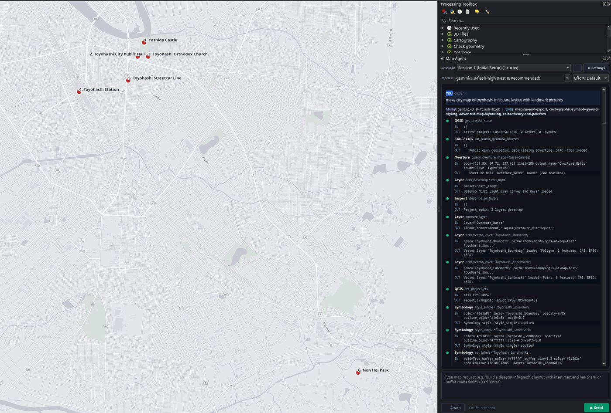
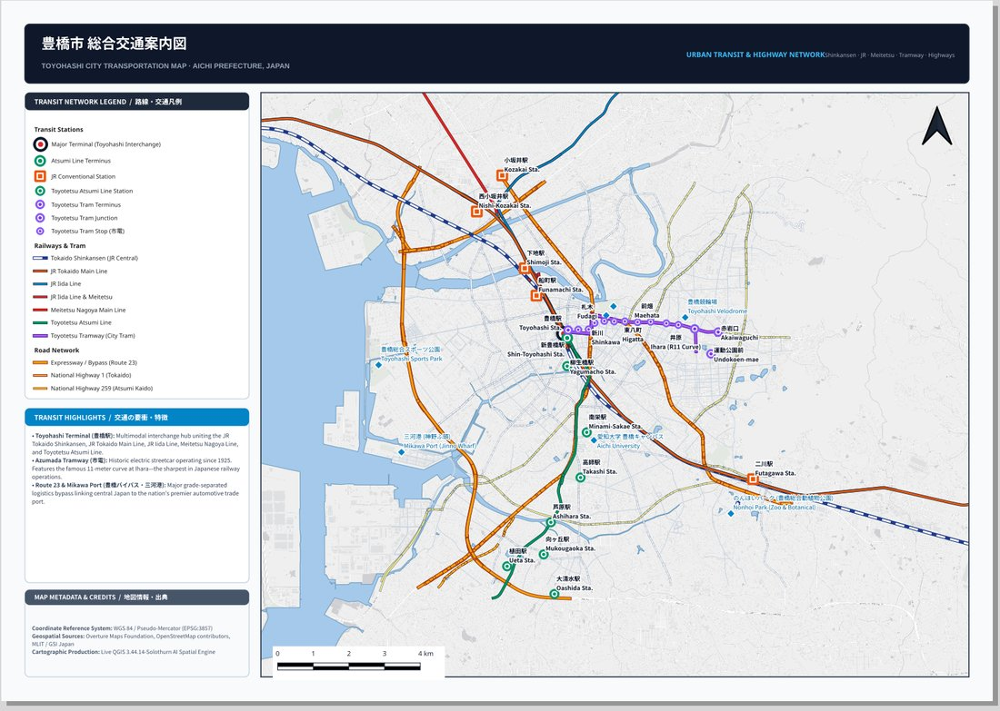
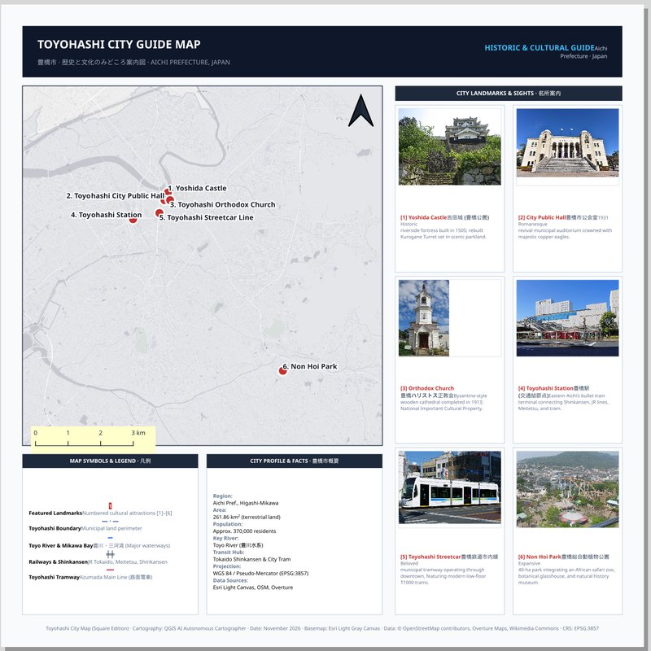
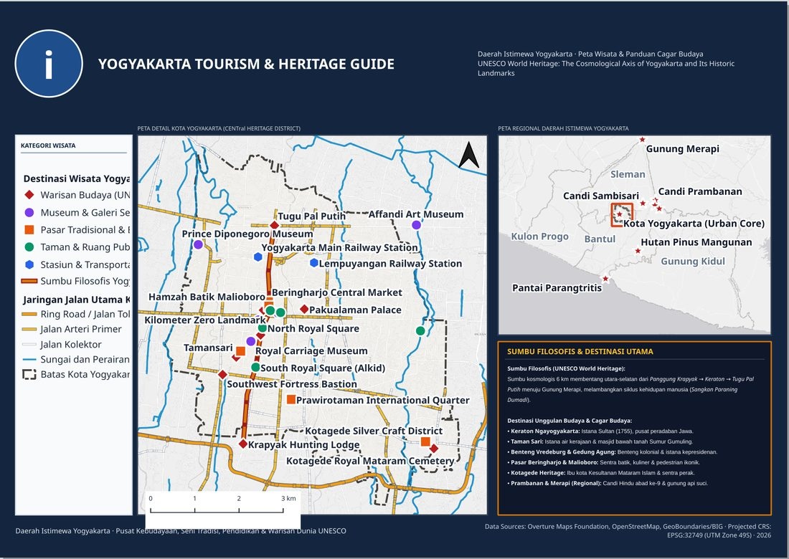

# QGIS AI Map Agent

[](https://qgis.org/)
[](https://www.gnu.org/licenses/gpl-3.0.html)
[](https://github.com/randyaswin/qgis-ai-agent/releases)
[](https://www.python.org/)
[](https://modelcontextprotocol.io/)

**QGIS AI Agent** is a full-featured QGIS plugin that turns AI coding CLIs (**Google Antigravity `agy`**, **Claude Code**, **Gemini CLI**, **Codex**) into autonomous geospatial copilots via the **Model Context Protocol (MCP)**. 

From a single prompt, the agent searches authentic open data, performs spatial analysis, designs thematic symbology, and composes publication-grade print layouts directly inside your active QGIS session.

---


*Live QGIS desktop environment featuring the integrated AI Agent Dock Panel running alongside the active map canvas.*

---

## 🏛️ System Architecture & Workflow

```
┌────────────────────────────────────────────────────────────────────────┐
│ QGIS Desktop GUI (Main Thread)                                         │
│                                                                        │
│  ┌───────────────────────┐         ┌────────────────────────────────┐  │
│  │ AI Chat Dock Panel    │         │ QGIS Active Project (.qgz)     │  │
│  │ • Prompt Composer     │         │ • Layers & Symbology           │  │
│  │ • Live Stream Chat    │         │ • 5 Layout Archetypes          │  │
│  │ • Skill Selector      │         │ • Auto-save Checkpoints        │  │
│  └───────────┬───────────┘         └───────────────▲────────────────┘  │
│              │                                     │                   │
│              ▼                                     │                   │
│  ┌───────────────────────┐         ┌───────────────┴────────────────┐  │
│  │ QProcess CLI Runner   │         │ ToolServer (Local Socket)      │  │
│  │ (agy / claude / etc.) │         │ • 51+ Deep PyQGIS Tools        │  │
│  └───────────┬───────────┘         └───────────────▲────────────────┘  │
└──────────────┼─────────────────────────────────────┼───────────────────┘
               │ stdio                               │ TCP (Auth Token)
               ▼                                     │
      ┌─────────────────┐                            │
      │  mcp_bridge.py  │────────────────────────────┘
      │  (MCP Server)   │
      └─────────────────┘
```

---

## 🗺️ Sample Maps Generated by QGIS AI Agent

Finished cartographic outputs created autonomously by QGIS AI Agent from prompt to print layout:

| 🚆 **Urban Transit & Highway Network** | 🏛️ **City Guide & Wayfinding** | 🕌 **Tourism & UNESCO Heritage Guide** |
| :---: | :---: | :---: |
| <a href="docs/images/sample-transit-map.jpg"></a> | <a href="docs/images/sample-city-guide.jpg"></a> | <a href="docs/images/sample-tourism-guide.jpg"></a> |
| *Multi-line railway styling, tramway routes, cased expressways, and station categorization.* | *Square wayfinding layout with landmark photos, bilingual subtitles, and city profile facts.* | *Multi-frame regional locator inset, UNESCO cosmological axis heritage corridor, categorized POIs, and summary callout panel.* |

---

## ✨ Key Capabilities

### 1. 🎨 5 Distinct Cartographic Layout Archetypes
Layouts adapt to your domain theme. The agent never forces generic templates on specialized maps:
* **`planning_official`:** Formal spatial planning and zoning master plans. Large hero map with coordinate grid ticks, paired with a right-hand margin block containing the title, north arrow & scale, zoning legend, locator inset map, and projection specifications.
* **`infographic_disaster` (Situational Crisis Dashboard):** Emergency hazard monitoring (flood, earthquake, wildfire). High-contrast alert banner, KPI cards (*Total Affected Area, Population at Risk, Emergency Shelter status*), and bottom risk gradient scale.
* **`natgeo` (National Geographic Editorial):** Warm parchment paper tone (`#fcfbf7`), double neatline borders (0.8mm outer, 0.25mm inner), centered classic Georgia serif typography, floating framed legend, and single-box scale bar.
* **`statistical_thematic` (Demographic & Socio-Economic Atlas):** Clean white canvas, main choropleth map frame (76% width), and right sidebar with distribution stats (*Mean, Median, Min, Max*) and quantile/jenks class breaks.
* **`relief_topographic` (Swiss Alpine Relief):** Imhof-style mountain terrain, elevation tint strip, subtle cross-coordinate grid, and contour annotations.

### 2. 🌐 Zero Data Fabrication & Real Geospatial Streaming
* **Mandatory Source Attribution:** The AI agent is strictly forbidden from fabricating mock coordinates or dummy geometries. All features must be sourced from authentic open geodata.
* **Overture Maps Foundation (DuckDB S3):** Stream global buildings, POIs, transportation networks, and water bodies directly from S3 GeoParquet without downloading entire gigabyte archives.
* **Public COGs & STAC Integration:** Stream Cloud-Optimized GeoTIFFs (Copernicus DEM 30m, ESA WorldCover, Sentinel-2, Landsat) on-the-fly via `/vsicurl/`.
* **Keyless XYZ Basemaps:** Preconfigured with Esri Light Canvas, OpenStreetMap, Esri Satellite, CartoDB Positron, and Esri Topo.

### 3. 🧠 56 GIS Domain Skills with Multilingual Smart Selection
* **22 Custom Specialized Skills:** Cartographic symbology, label hierarchy (PAL engine), color theory & colorblind safety, thematic mapping (bivariate, dasymetric, cartograms), multiscale LOD generalization, disaster dashboards, network accessibility, and landcover statistics.
* **34 Vendored Open-Source Skills:** GeoAI spatial statistics, LiDAR point cloud processing, MCDA suitability analysis, remote sensing indices, and PostGIS spatial SQL.
* **Smart Auto-Selection:** Powered by multi-word phrase matching, custom skill boost, and meta-orchestrator downranking across **English**, **Japanese (日本語)**, and **Indonesian (Bahasa Indonesia)**.

### 4. 🛡️ Fault Tolerance & Session Resumption
* **Project Auto-Save Checkpoints:** Automatically saves `.qgz` project snapshots after tool execution. If QGIS closes or crashes, sessions can resume seamlessly from disk.
* **Project-Bound Context:** Chat history, CLI sessions, and tool outputs are serialized directly into the `.qgz` project file and mirrored locally in `~/.qgis_ai_agent/`.

---

## 🚀 Installation

### Option A: Install via QGIS Plugin Manager (Recommended)
1. Download the latest `qgis_ai_agent-1.0.0.zip` from [Releases](https://github.com/randyaswin/qgis-ai-agent/releases).
2. In QGIS, navigate to **Plugins** ➔ **Manage and Install Plugins...**
3. Select **Install from ZIP**, choose the downloaded zip file, and click **Install Plugin**.
4. Activate the plugin: check **QGIS AI Agent** in the plugin list.

### Option B: Manual Installation via Git
Clone this repository directly into your QGIS 3 Python plugins directory:

* **Linux**:
  ```bash
  cd ~/.local/share/QGIS/QGIS3/profiles/default/python/plugins
  git clone https://github.com/randyaswin/qgis-ai-agent.git qgis_ai_agent
  ```
* **macOS**:
  ```bash
  cd ~/Library/Application\ Support/QGIS/QGIS3/profiles/default/python/plugins
  git clone https://github.com/randyaswin/qgis-ai-agent.git qgis_ai_agent
  ```
* **Windows (PowerShell)**:
  ```powershell
  cd "$env:APPDATA\QGIS\QGIS3\profiles\default\python\plugins"
  git clone https://github.com/randyaswin/qgis-ai-agent.git qgis_ai_agent
  ```

Restart QGIS and enable **QGIS AI Agent** in the Plugins menu.

---

## ⚙️ Prerequisites & Setup

1. **AI CLI Installed on your System PATH:**
   Install at least one supported AI CLI tool:
   * **Google Antigravity (`agy`)** *(Recommended)*
   * **Claude Code (`claude`)**: `npm install -g @anthropic-ai/claude-code`
   * **Gemini CLI (`gemini`)**
   * **OpenAI Codex (`codex`)**
2. **DuckDB (Optional for Overture Maps & Parquet queries):**
   ```bash
   pip install duckdb
   ```
   *(DuckDB is auto-detected. If missing, the plugin falls back to standard QGIS vector/raster data sources).*

---

## 🛠️ Complete MCP Tool Catalog (51+ Tools)

| Category | Tools | Description |
| :--- | :--- | :--- |
| **Project & Canvas** | `get_project_state`, `set_project_crs`, `new_project`, `open_project`, `save_project`, `zoom_to`, `snapshot_canvas` | Project lifecycle, projection management, and visual screenshot feedback. |
| **Data Inspection** | `describe_layer`, `describe_all_layers`, `get_features`, `get_selected_features`, `field_stats`, `sample_raster` | Deep vector schema, geometry, statistics, null counts, and raster pixel inspection. |
| **Public Open Data** | `list_public_geodata_sources`, `search_stac_items`, `load_public_cog`, `query_overture_maps`, `query_duckdb_spatial`, `add_basemap` | STAC catalog search, COG streaming, Overture Maps S3 querying, and XYZ basemaps. |
| **Symbology & Styling** | `style_single`, `style_categorized`, `style_graduated`, `style_raster`, `load_style`, `list_color_ramps`, `set_labels` | Complete cartographic rendering, cased roads, color ramps, and PAL typography. |
| **Print Layouts** | `create_styled_layout`, `create_layout`, `add_layout_map`, `add_layout_shape`, `add_layout_text`, `add_layout_legend`, `add_layout_scalebar`, `add_layout_north_arrow`, `add_layout_inset_map`, `add_layout_infographic_chart`, `export_layout` | Composable print design across 5 archetypes, inset locators, and export (PDF/PNG/SVG). |
| **Processing & GIS** | `list_processing_providers`, `list_algorithms`, `describe_algorithm`, `run_processing`, `open_processing_toolbox`, `open_model_designer` | Full access to 440+ native C++, GDAL, and GRASS processing algorithms. |
| **Digitizing & GCP** | `georeference_raster`, `create_vector_layer`, `digitize_features`, `check_validity` | Georeference aerial scans via GCPs, scaffold GeoPackages, and digitize geometries. |
| **Skills Registry** | `list_skills`, `load_skill` | Search and inject 56 specialized domain cartography and GIS analytical skills. |

---

## 📦 Packaging & Release for QGIS Plugins Repository

This repository includes automated packaging scripts and a GitHub Actions CI/CD workflow to produce compliant ZIP archives ready for upload to [plugins.qgis.org](https://plugins.qgis.org/):

### Local Packaging
Generate the upload-ready ZIP archive locally at any time:
```bash
python3 scripts/package_plugin.py
```
This validates `metadata.txt`, strips unwanted cache/OS files, and outputs:
* `dist/qgis_ai_agent.zip` (ready for plugins.qgis.org upload or manual QGIS ZIP install)
* `dist/qgis_ai_agent-<version>.zip` (versioned release asset)
* `dist/checksums.sha256` (SHA-256 integrity checksums)

### Automated GitHub Actions Release
To publish an official release with attached ZIP assets on GitHub:
1. Update `version` and `changelog` in [`qgis_ai_agent/metadata.txt`](qgis_ai_agent/metadata.txt).
2. Tag and push to GitHub:
   ```bash
   git tag v1.0.0
   git push origin v1.0.0
   ```
3. The GitHub Actions workflow ([`.github/workflows/release.yml`](.github/workflows/release.yml)) automatically validates the package, builds the release ZIPs, and attaches them to a new GitHub Release.
4. You can also trigger the packaging workflow manually from the **Actions** tab in GitHub via **Run workflow**.

---

## 📄 License & Compliance

This plugin is licensed under the **GNU General Public License v3.0 or later (GPL-3.0-or-later)** in full compliance with the [QGIS Plugin Repository Guidelines](https://plugins.qgis.org/) and the GNU GPL ecosystem of QGIS.

See the [LICENSE](LICENSE) file for the full license text.

### Third-Party Components & Credits:
* **Vendored Skills:** MIT License (GeoAI Skills, OpenMapStack, QGIS Claude Skill Package).
* **Basemaps:** OpenStreetMap (© OpenStreetMap contributors, ODbL), Esri Basemaps (Esri, HERE, Garmin).
* **Open Geospatial Data:** Overture Maps Foundation (CDLA Permissive 2.0 / ODbL), Copernicus Sentinel data (European Commission).

---

## 👤 Author & Support

* **Author:** M. Randy Aswin
* **Email:** [mrandyaswin@gmail.com](mailto:mrandyaswin@gmail.com)
* **Bug Tracker & Issues:** [https://github.com/randyaswin/qgis-ai-agent/issues](https://github.com/randyaswin/qgis-ai-agent/issues)
* **Repository:** [https://github.com/randyaswin/qgis-ai-agent](https://github.com/randyaswin/qgis-ai-agent)

Contributions, pull requests, and bug reports are warmly welcome!
