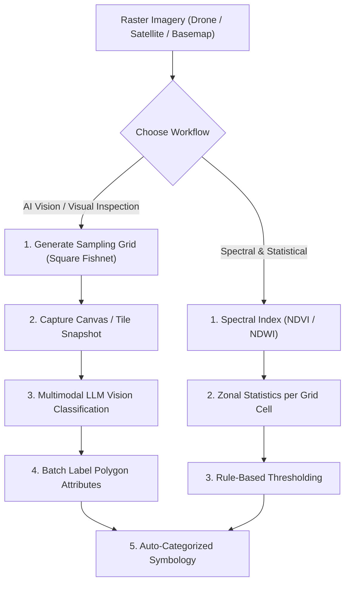

# Raster Interpretation & Grid-Based Polygon Classification Guide

This skill provides an end-to-end methodology for **visual interpretation of raster imagery** and **transforming continuous raster extents into categorized, labeled square (fishnet) or hexagonal polygon grids** inside QGIS.

---

## 1. Core Visual Interpretation Elements

When interpreting optical imagery (drone RGB, high-resolution aerial surveys, or satellite multi-spectral bands), systematically evaluate the **Seven Primary Visual Keys**:

| Key Element | Optical / Physical Meaning | Diagnostic Use in Classification |
| :--- | :--- | :--- |
| **Tone / Color** | Relative reflectance of electromagnetic radiation across RGB/NIR bands. | Water appears dark/blue/black; vegetation appears green (or bright red in false-color NIR); asphalt is dark grey; bare soil is tan/brown. |
| **Texture** | Frequency of tonal change across neighboring pixels (smooth vs. rough/granular). | Water and smooth lawns have uniform, smooth textures; forest canopies exhibit rough, pebbled, granular textures; ploughed fields have corrugated linear textures. |
| **Pattern** | Spatial arrangement of identifiable objects into characteristic configurations. | Orthogonal street grids indicate planned urban areas; organic irregular clusters suggest informal settlements or natural woodlands; rows indicate orchards or plantations. |
| **Shape** | Geometric outline of surface features. | Sharp geometric squares/rectangles represent human structures (buildings, paddies, swimming pools); irregular organic shapes represent natural forests, water bodies, or wetlands. |
| **Size** | Dimensions relative to known features in the scene (using scale bar or pixel resolution). | Differentiates single-family homes ($80-250\text{ m}^2$) from industrial warehouses ($2,000-20,000\text{ m}^2$). |
| **Shadow** | Profile silhouettes cast by elevated features under oblique solar illumination. | Reveals heights of buildings, telecommunication towers, bridges, or tree canopy heights; distinguishes flat ground decals from 3D structures. |
| **Site / Association** | Contextual location relative to surrounding topography and infrastructure. | Boats are adjacent to water bodies; schools possess athletic tracks; fuel tanks reside near ports or refineries. |

---

## 2. The Two Classification Workflows

Depending on the task requirements, choose between:



---

## 3. Workflow A: Grid-Based Visual & AI Vision Classification

Use this workflow to partition an area into discrete square evaluation cells (e.g. $50\text{ m} \times 50\text{ m}$ or $100\text{ m} \times 100\text{ m}$) and assign classes like Land Cover, Disaster Damage Grade, or Rooftop Solar Presence.

### Step 1: Inspect Raster Extent & CRS
Always verify the target raster CRS and resolution before creating grids:
```python
describe_layer(layer="orthomosaic_study_area")
```

### Step 2: Create Regular Square (Fishnet) Grid
Call the dedicated tool `create_sampling_grid`:
```python
create_sampling_grid(
    layer_name="LULC_Grid_100m",
    extent_layer="orthomosaic_study_area",
    cell_size=100.0,       # In layer CRS units (e.g. 100 meters in UTM)
    grid_type="square",    # 'square' (Rectangle, default) or 'hexagon'
    crs="EPSG:32748"       # Use projected CRS for metric spacing
)
```
*Result:* Automatically generates polygon cells with `grid_id`, `class`, `confidence`, and `notes` fields, styled with a clean transparent fill so the imagery beneath remains fully visible.

### Step 3: Capture Canvas Snapshot for Visual Inspection
Zoom to the evaluation extent and snapshot the canvas:
```python
zoom_to(layer="LULC_Grid_100m", margin=0.02)
snapshot_canvas(width=1200, height=800)
```
*Visual Evaluation:* The agent inspects the returned image, examining the visual keys (tone, texture, pattern, shape) for each numbered grid cell.

### Step 4: Batch-Assign Classification Labels
Once classes are determined, batch-update the grid cells via `label_grid_cells`:
```python
label_grid_cells(
    layer="LULC_Grid_100m",
    labels=[
        {"grid_id": 1, "class": "Dense Forest", "confidence": 0.95, "notes": "Granular canopy texture"},
        {"grid_id": 2, "class": "Dense Forest", "confidence": 0.92, "notes": "Canopy"},
        {"grid_id": 3, "class": "Water Body", "confidence": 0.98, "notes": "River channel"},
        {"grid_id": 4, "class": "Built-Up", "confidence": 0.89, "notes": "Residential buildings"},
        {"grid_id": 5, "class": "Agriculture", "confidence": 0.91, "notes": "Geometric crop parcel"},
        {"grid_id": 6, "class": "Bare Soil", "confidence": 0.85, "notes": "Cleared ground"}
    ],
    auto_style=True  # Automatically applies categorized colors
)
```

### Step 5: Area & Proportion Summary
Compute total area per category:
```python
calculate_field(
    layer="LULC_Grid_100m",
    field="area_ha",
    expression="$area / 10000",
    field_type="double"
)
```

---

## 4. Workflow B: Spectral Zonal Statistics & Thresholding

For multispectral imagery (e.g. Sentinel-2 bands or 4-band drone multispectral):

### Step 1: Compute NDVI or Spectral Index via Raster Calculator
```python
run_processing(
    algorithm="native:rastercalculator",
    params={
        "EXPRESSION": "(\"Sentinel2@4\" - \"Sentinel2@3\") / (\"Sentinel2@4\" + \"Sentinel2@3\")",
        "LAYERS": ["Sentinel2"],
        "OUTPUT": "TEMPORARY_OUTPUT"
    },
    output_name="NDVI"
)
```

### Step 2: Compute Mean Index per Grid Cell (Zonal Statistics)
```python
run_processing(
    algorithm="native:zonalstatisticsfb",
    params={
        "INPUT_RASTER": "NDVI",
        "RASTER_BAND": 1,
        "INPUT_VECTOR": "LULC_Grid_100m",
        "COLUMN_PREFIX": "ndvi_",
        "STATISTICS": [2],  # 2 = Mean
        "OUTPUT": "TEMPORARY_OUTPUT"
    },
    output_name="Grid_with_NDVI"
)
```

### Step 3: Classify Using QGIS Expressions
```python
calculate_field(
    layer="Grid_with_NDVI",
    field="class",
    expression="CASE "
               "WHEN \"ndvi_mean\" < 0.0 THEN 'Water Body' "
               "WHEN \"ndvi_mean\" >= 0.0 AND \"ndvi_mean\" < 0.2 THEN 'Built-Up / Bare' "
               "WHEN \"ndvi_mean\" >= 0.2 AND \"ndvi_mean\" < 0.5 THEN 'Sparse Vegetation / Crop' "
               "ELSE 'Dense Forest' "
               "END"
)
```

### Step 4: Apply Standard Categorized Palette
```python
style_categorized(layer="Grid_with_NDVI", field="class", ramp="Viridis")
```

---

## 5. Standard LULC Palette Mapping

When styling classified grid polygons, adhere to international cartographic standards:

| Class Name | Hex Code | Opacity | Border Color | Description |
| :--- | :--- | :--- | :--- | :--- |
| **Water Body** | `#0284c7` | 0.75 | `#0369a1` | Rivers, reservoirs, oceans, flooded wetlands |
| **Dense Forest** | `#1b5e20` | 0.75 | `#0f3d13` | Closed natural canopy, conservation woodland |
| **Open Vegetation / Plantation** | `#4caf50` | 0.70 | `#2e7d32` | Shrubs, estate crops, tree nurseries |
| **Agriculture / Cropland** | `#cddc39` | 0.70 | `#9e9d24` | Seasonal crops, vegetable gardens, paddies |
| **High-Density Urban** | `#dc2626` | 0.75 | `#991b1b` | Commercial centers, compact settlements |
| **Residential / Suburban** | `#f87171` | 0.70 | `#dc2626` | Housing complexes, low-density villas |
| **Industrial / Logistics** | `#9333ea` | 0.75 | `#6b21a8` | Factories, warehouses, port logistics |
| **Bare Land / Construction** | `#d97706` | 0.70 | `#b45309` | Earthworks, quarries, sandy riverbeds |

---

## 6. Layout Presentation for Grid Classification

Present the final classified grid using the dedicated layout tools:

```python
create_styled_layout(
    name="LULC_Grid_Assessment",
    style_theme="statistical_thematic",
    title="LAND USE & COVER GRID CLASSIFICATION",
    subtitle="100m Fishnet Multi-Spectral Interpretation · Regional Spatial Assessment",
    credits="Copernicus Sentinel-2 / UAV Survey · QGIS Copilot",
    extent_layer="LULC_Grid_100m",
    page_size="A4",
    orientation="landscape"
)

# Add infographic distribution breakdown
add_layout_infographic_chart(
    layout="LULC_Grid_Assessment",
    x=215, y=45, width=70, height=55,
    title="AREA DISTRIBUTION (HA)",
    subtitle="Class summary across study area",
    data=[
        {"label": "Dense Forest", "value": 420},
        {"label": "Agriculture", "value": 285},
        {"label": "Built-Up", "value": 190},
        {"label": "Water Body", "value": 85},
        {"label": "Bare Land", "value": 45}
    ],
    bar_color="#2e7d32"
)

# Verify with preview
snapshot_layout(name="LULC_Grid_Assessment", dpi=120)
```

